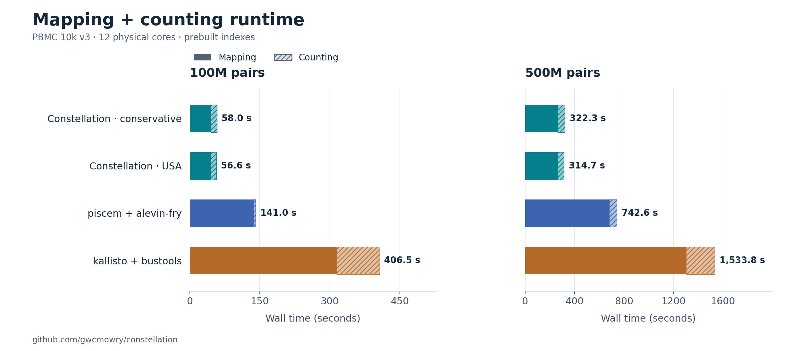
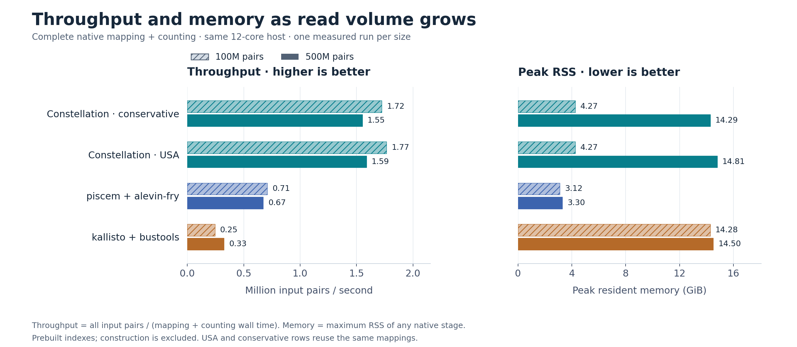
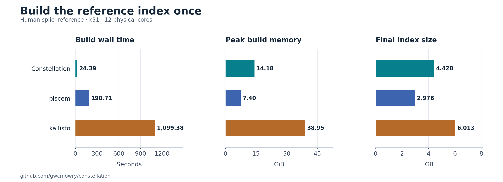

# Constellation

Constellation maps 10x 3′ v3 single-cell RNA-seq read pairs to genes and counts
molecules by cell. It can retain spliced, unspliced and ambiguous reference-class
assignments. The implementation is Rust; the recommended workflow builds a
reusable index and runs one `quant` command per sample.

It produces gene-level count matrices, not BAM alignments or transcript/isoform
abundances. Cell calling is external: supply the barcodes of the cells you want
to quantify. See [state semantics](docs/splicing_state.md) for interpreting S/U/A.

[Install](#install) · [Quickstart](#quickstart) · [Inputs](#inputs) ·
[Outputs](#outputs) · [Performance](#current-performance) · [Development](#development)

## Install

### Prebuilt Linux archive

Check [GitHub Releases](https://github.com/gwcmowry/constellation/releases) for
published packages. The release workflow builds a **static Linux x86_64** archive
with checksums, an installer, build provenance and the tiny example. It uses the
baseline x86-64 CPU target and needs no Rust toolchain or host glibc at runtime.
Other platforms currently use the source-build path below.

In the directory containing the archive and its `.sha256` file, substitute the
filename you downloaded (or built locally):

```bash
archive=constellation-0.1.0-x86_64-unknown-linux-musl.tar.gz
sha256sum -c "${archive}.sha256"
tar -xzf "$archive"
cd "${archive%.tar.gz}"
sh install.sh
```

This installs into `~/.local/bin`; ensure that directory is on `PATH`.
Use `sh install.sh --prefix /your/prefix` to choose another location, or run
`./constellation` directly. The archive's README includes the same runnable
example, so a source checkout is not required. Locally built development
snapshots are labeled `-dev-`; see the [release guide](docs/releases.md).

### Build from source

From a checkout of this repository, with [Rust and Cargo](https://rust-lang.org/tools/install/)
and a native C compiler/linker installed:

```bash
cargo install --locked --path crates/constellation-cli
constellation --version
constellation quant --help
```

This builds the release executable and installs it into Cargo's binary directory
(normally `~/.cargo/bin`). If the command is not found, ensure that directory is
on `PATH` or open a new terminal after Rust installation. `--locked` uses this
repository's dependency versions. See [Cargo installation options](https://doc.rust-lang.org/cargo/commands/cargo-install.html).
Linux x86_64 with Rust/Cargo 1.93.1 is the tested setup; other platforms have not
been validated. Gzip input support is built in. The optional zstd input/output
path requires the `zstd` executable.

For a local build without installation:

```bash
cargo build --locked --release -p constellation-cli
./target/release/constellation --help
```

Use that executable path in place of `constellation` in the examples below.

## Quickstart

### Try the bundled example

This tiny synthetic fixture needs no data downloads and checks installation,
index building, mapping and counting. Run from the repository root:

```bash
mkdir -p demo-output
constellation index-ec --threads 2 \
  --transcripts examples/quickstart/reference.fa \
  --t2g-map examples/quickstart/t2g.tsv \
  --format ptrhash --syncmer-s 20 \
  --out demo-output/reference.ecidx

constellation quant --threads 2 \
  --index demo-output/reference.ecidx \
  --r1 examples/quickstart/R1.fastq --r2 examples/quickstart/R2.fastq \
  --barcode-whitelist examples/quickstart/barcodes.txt \
  --out-dir demo-output/sample
```

Expected: **7 read pairs, 2 genes, 2 cells, 6 molecules** (4 spliced, 1 unspliced,
1 ambiguous). Inspect `demo-output/sample/count.metrics.json` and the matrices.
`quant` creates its output directory and refuses an existing path, so use a new
`--out-dir` when rerunning. Example outputs are ignored by git.

### Run your data

Build once from your prepared splici FASTA and its three-column annotation:

```bash
constellation index-ec --threads 12 \
  --transcripts reference/splici.fa \
  --t2g-map reference/t2g.tsv \
  --format ptrhash --syncmer-s 20 \
  --out reference/splici.ecidx
```

`k=31` and parallel partitioned construction are already defaults. Explicit
`--format ptrhash --syncmer-s 20` selects the fast index used in the benchmarks;
without those flags, `index-ec` still defaults to a dense mmap index.

Then run each sample against that index:

```bash
constellation quant --threads 12 \
  --index reference/splici.ecidx \
  --r1 sample_R1.fastq.gz --r2 sample_R2.fastq.gz \
  --barcode-whitelist accepted_cells.tsv.gz \
  --out-dir results/sample1
```

`quant` runs `map --splicing-state` followed by `count-splicing`, using forward
consensus mapping and conservative gene intersection with directional UMI
correction. It releases the mapper process before counting. It writes both
stages' metrics, checks their record totals, and removes its uncompressed
assignment intermediate after success. Add `--keep-assignments` to retain it
for re-counting. Failed runs retain partial outputs and `run.json` for diagnosis;
choose a new output directory to retry.

For optional USA resolution, add **`--resolution usa`**. `quant` automatically
uses exact UMIs for this policy; no second flag is needed. USA uses a spliced
preference in certain ties, so it changes inference, not just output formatting.
The conservative policy remains the default. See [resolution rules](docs/splicing_state.md#optional-usa-resolution).

`--threads N` sets Rayon workers for every stage and overrides
`RAYON_NUM_THREADS`. If omitted, that environment variable or the available CPU
count is used. Reader/output helper threads are additional. CPU pinning with
`taskset` is a benchmarking choice, not a setup requirement.

## Inputs

**R1 and R2 mean Read 1 and Read 2**, the standard names for the two mates in
paired-end sequencing. Their roles depend on the library protocol. For the
10x 3′ v3 layout supported here:

```text
R1: [16-base cell barcode][12-base UMI]  → which cell and molecule
R2: [RNA-derived sequence]             → which gene/reference class
```

For example, `sample_R1_001.fastq.gz` belongs in `--r1`, and its matching
`sample_R2_001.fastq.gz` belongs in `--r2`. A cell barcode identifies the cell;
a UMI tags an original molecule so PCR copies can be counted together.

- **Reference:** a prepared FASTA containing spliced transcript targets and
  intronic targets (for example, a splici reference). Genome/GTF preparation is a
  separate step and is excluded from the reported index build times.
- **Annotation:** a plain, headerless tab-separated file with `target_id`,
  `gene_id`, and reference class `S` or `U`. IDs must match the FASTA's first
  whitespace-delimited header token. Two-column/unannotated indexes do not
  provide complete splicing-state evidence. Reference token `A` means antisense,
  not the ambiguous output state.
- **Reads:** one matched R1/R2 file pair, plain FASTQ or `.gz`, in the same read
  order. The implemented chemistry is the 10x 3′ v3 layout: R1 has a 16-base
  barcode followed by a 12-base UMI, and R2 contains the biological read.
- **Cells:** one accepted 16-base barcode per line, plain text or gzip. A `-1`
  suffix is accepted. This should describe the cells to quantify; supplying a
  chemistry-wide barcode list does not perform cell calling.

For multiple lanes of the **same library**, concatenate each mate in matching
lane order before running; concatenated gzip members are supported. Process
independent libraries separately to avoid merging reused barcode identities.

A tiny annotation example (literal tabs):

```text
target_spliced	GENE_A	S
target_intronic	GENE_A	U
```

See the [bundled reference and inputs](examples/quickstart/). Building an index
requires scratch space (`TMPDIR` controls temporary partitions). Counting retains
evidence in memory: the 500M test used about 14–15 GiB, not constant memory.
The temporary assignment file was about 16.2 GiB at 500M pairs, in addition to
inputs, index and final matrices; cleanup happens after counting.

## Outputs

All matrices are Matrix Market files with **genes as rows and cells as columns**.
Axes are `counts_features.tsv` and `counts_barcodes.tsv` in the output directory.

| File | Contents |
|---|---|
| `counts_matrix.mtx` | Total molecule counts; exactly S + U + ambiguous |
| `counts_spliced.mtx` | Spliced-compatible molecules |
| `counts_unspliced.mtx` | Unspliced-compatible molecules |
| `counts_ambiguous.mtx` | Both-compatible, conflicting and unknown-state molecules |
| `counts_compatible_both.mtx` | Both-compatible component of ambiguous counts |
| `counts_conflicting.mtx` | Conflicting-state component |
| `counts_unknown.mtx` | Missing-state-evidence component |
| `map.metrics.json`, `count.metrics.json` | Assignment, barcode, molecule and timing metrics |
| `run.json` | Completion status, command, counting policy and stage wall times |
| `assignments.cstrad2` | Per-read gene/state evidence; kept only with `--keep-assignments` on success |

S/U/A are reference compatibility states, not definitive molecular labels or a
validated complete RNA-velocity analysis. Constellation's CSTRAD formats are
internal formats, not alevin-fry-compatible RAD. `count-splicing` requires
CSTRAD2; TSV is for inspection. Ordinary `map` keeps splicing-state output off
unless `--splicing-state` is selected. For separate stages, compressed
intermediates and diagnostics, see [the state-aware workflow](docs/splicing_state.md).

## Current Performance

<!-- BENCHMARK RESULTS START -->
### 100M and 500M paired reads

Real PBMC 10k v3 reads, Ryzen 9 7900X / 64 GB RAM, twelve physical cores.
**One timed pass per workflow and size**, run serially with prebuilt indexes.
All methods receive identical compressed FASTQs and the same 11,769-cell list.
Spliced/unspliced/ambiguous output is enabled throughout. Timings include native
index loading, mapping output and the complete correction/grouping/counting
pipeline through matrix writing. Index builds and input preparation are excluded
from these first tables; build costs are reported separately below.



[Vector SVG](experiments/2026-11-01-large-scale/figures/pipeline_runtime.svg). Hatched segments are counting;
each panel has its own linear time axis. No error bars are implied by one run.

For sharing: [runtime versus read count (PNG)](experiments/2026-11-01-large-scale/figures/runtime_vs_read_pairs.png)
or [vector SVG](experiments/2026-11-01-large-scale/figures/runtime_vs_read_pairs.svg).

| Pairs | Workflow | Map (s) | Count (s) | Total (s) | Peak RSS (GiB) |
|---|---|---:|---:|---:|---:|
| 100M | Constellation · conservative | 44.70 | 13.28 | **57.98** | 4.27 |
| 100M | Constellation · USA | 44.70 | 11.90 | **56.60** | 4.27 |
| 100M | piscem + alevin-fry | 136.09 | 4.93 | **141.02** | 3.12 |
| 100M | kallisto + bustools | 314.42 | 92.08 | **406.50** | 14.28 |
| 500M | Constellation · conservative | 261.79 | 60.46 | **322.25** | 14.29 |
| 500M | Constellation · USA | 261.79 | 52.92 | **314.71** | 14.81 |
| 500M | piscem + alevin-fry | 680.69 | 61.96 | **742.65** | 3.30 |
| 500M | kallisto + bustools | 1303.07 | 230.71 | **1533.78** | 14.50 |

At 500M pairs, the conservative Constellation workflow is
**2.30× faster than piscem/alevin-fry** and
**4.76× faster than kallisto/bustools** in these runs.
The conservative row includes directional UMI correction. The optional USA row
uses `--resolution usa --no-correct-umis` on the same mappings. Competitor rows
use exact UMIs with their native resolution rules; their statistical computations
and mapping evidence are not identical.
Competitor versions: piscem 0.24.0, alevin-fry 0.19.0, kallisto 0.52.0,
bustools 0.45.1.



[Vector SVG](experiments/2026-11-01-large-scale/figures/throughput_memory.svg). Throughput uses **all input
pairs divided by mapping + counting wall time**. Peak memory is the largest
native stage RSS, not the sum of stages. Constellation's mapping stays near
4.27 GiB; its default counting grows from
3.63 to 14.29 GiB.
At 500M, 49.19 of
60.46 counting seconds go into serial ingestion/partitioning.

The optional USA output has S/U/A Pearson correlations of
**0.9992 / 0.9899 /
0.9983** with piscem/alevin-fry at 500M,
with weighted count overlap **0.9329**.
All six mapping runs processed the exact requested input counts and all 24
state matrices passed validation. These measurements establish a lead among
the tested configurations on this dataset; agreement is not biological ground
truth, and broader SOTA claims require more methods and independent datasets.

### Index construction and first-sample cost



[Vector SVG](experiments/2026-11-01-large-scale/figures/index_build.svg). Prior measurements from this same
Ryzen 9 7900X host, twelve physical cores, one fresh build per tool from the same
prepared Ensembl 93 splici FASTA (k31). No builds or large read tests were rerun
to make these figures. Reference preparation from genome/GTF is excluded.

| Builder | Build wall time (s) | Peak RSS (GiB) | Index size (GB) |
|---|---:|---:|---:|
| Constellation | **24.39** | 14.18 | 4.428 |
| piscem | **190.71** | 7.40 | 2.976 |
| kallisto | **1099.38** | 38.95 | 6.013 |

**Calculated build + mapping + counting totals:** the saved build time plus
the measured sample workflow, not a new combined timing run.

| Workflow | 100M pairs (s) | 500M pairs (s) |
|---|---:|---:|
| Constellation · conservative | 82.37 | 346.64 |
| Constellation · USA | 80.99 | 339.10 |
| piscem + alevin-fry | 331.73 | 933.36 |
| kallisto + bustools | 1505.88 | 2633.16 |

Constellation's measured build is 7.82× faster than piscem's and 45.07×
faster than kallisto's. Build cost is independent of input read volume **for a
fixed reference and configuration** and can be amortized across samples.
The indexes retain different information: Constellation uses sparse k31/s20
gene/state keys; the competitors build denser target/path graphs. These are
native workflow costs, not equal-information index-construction workloads.
GB denotes decimal disk size; GiB denotes binary memory size.

[Build protocol and original measurements](experiments/2026-11-01-competitor-stages/README.md) ·
[Raw build results](experiments/2026-11-01-competitor-stages/raw/summary.json).


[Full scaling protocol, outputs and bottlenecks](experiments/2026-11-01-large-scale/README.md) ·
[Raw timings](experiments/2026-11-01-large-scale/raw/summary.json) · [Matrix comparisons](experiments/2026-11-01-large-scale/raw/matrix-comparison.json) ·
[Reproducible figure script](experiments/2026-11-01-large-scale/plots.py).
<!-- BENCHMARK RESULTS END -->

## Earlier results and design notes

- [Build/count optimization and policy controls](experiments/2026-10-31-build-count/README.md).
- [Independent source-origin accuracy and consensus mapping](experiments/2026-10-30-consensus/README.md).
- [Historical throughput improvements](experiments/2026-10-27-packed-pipeline/README.md).
- [Archived README measurements](docs/archive/readme-performance-history-2026-11-01.md), including superseded layouts and the early simpleaf comparison.
- [Architecture](docs/architecture.md), [performance roadmap](docs/performance_roadmap.md), and [rejected experiments](docs/failed_performance_experiments.md).

## Development

```bash
cargo fmt --all --check
cargo test --locked --workspace
cargo build --locked --release --workspace
```

CLI integration tests compare `quant` with the separate mapping/counting stages
and verify the bundled example, USA selection, intermediate cleanup and failure
handling. Keep benchmark data, generated indexes and profiler dumps outside git.
The checked-in figures are regenerated from saved JSON; see the
[figure reproduction commands](experiments/2026-11-01-large-scale/README.md#regenerating-the-figures-and-tables).

For Rust performance work, use `cargo flamegraph` to localize hot paths, then
`perf stat` for hardware counters where supported. Save raw profiles before
summarizing them. Host permissions determine whether perf collection is
available. Reproduce the published measurements with their documented twelve-core
settings; ordinary users can choose their own thread count.
