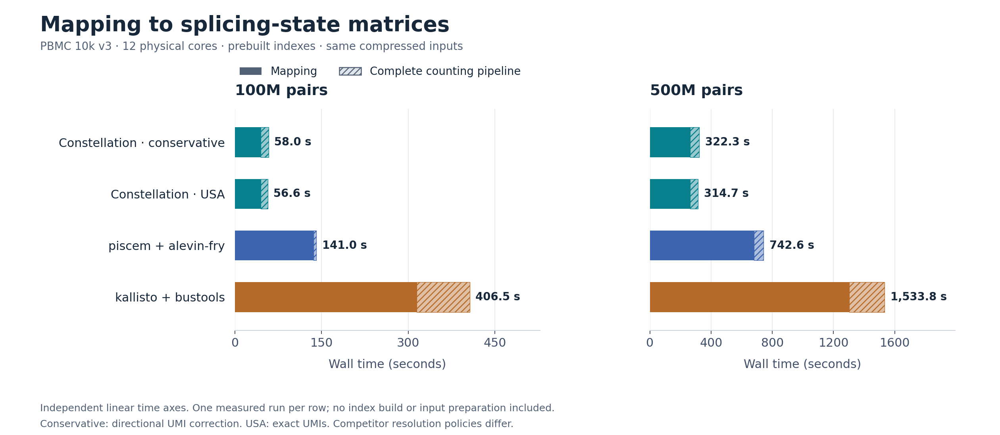
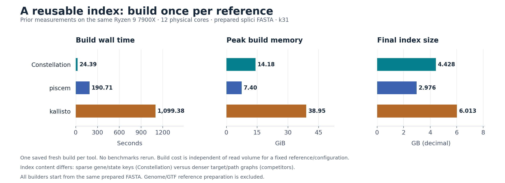
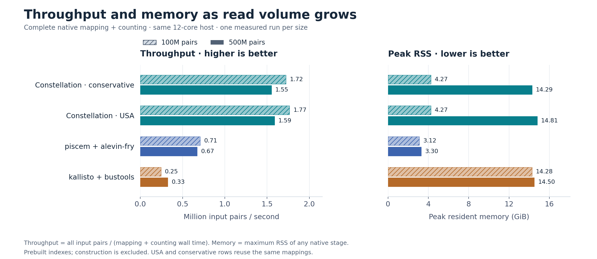

# 100M and 500M paired-read scaling comparison

This experiment runs the frozen Constellation gene/splicing-state mapper and
counter against piscem 0.24.0 + alevin-fry 0.19.0 and kallisto 0.52.0 + bustools
0.45.1. It uses genuine additional reads from the existing PBMC 10k v3 library.
Production code is unchanged.

Host: Ryzen 9 7900X, 64 GB RAM. CPU affinity selects one logical CPU on each
of twelve distinct physical cores; the host is not exclusively reserved.
No GPU is used. [Hardware/topology record](raw/host.json).

## Measured results

**One timed pass per tool and size**, same genuine paired reads, twelve cores,
prebuilt indexes. Combined times are mapping plus the complete native counting
pipeline. They exclude input preparation, index construction, validation and
optional additional counting policies.



[Vector SVG](figures/pipeline_runtime.svg). Counting is hatched; panels use
independent linear time axes. The USA row reuses the same Constellation mapping.

| Pairs | Workflow | Mapping | Counting | Combined | Peak pipeline RSS |
|---|---|---:|---:|---:|---:|
| 100M | Constellation, conservative | 44.70s | 13.28s | 57.98s | 4.27 GiB |
| 100M | piscem + alevin-fry | 136.09s | 4.93s | 141.02s | 3.12 GiB |
| 100M | kallisto + bustools | 314.42s | 92.08s | 406.50s | 14.28 GiB |
| 500M | Constellation, conservative | 261.79s | 60.46s | 322.25s | 14.29 GiB |
| 500M | piscem + alevin-fry | 680.69s | 61.96s | 742.65s | 3.30 GiB |
| 500M | kallisto + bustools | 1303.07s | 230.71s | 1533.78s | 14.50 GiB |

At 100M, Constellation's complete native workflow is **2.43× faster than piscem/alevin-fry** and **7.01× faster than kallisto/bustools** in these runs.

At 500M, Constellation's complete native workflow is **2.30× faster than piscem/alevin-fry** and **4.76× faster than kallisto/bustools** in these runs.

The default Constellation count includes directional UMI edit correction;
the competitor settings here use exact UMIs and different resolution rules.
Those are native workflow comparisons, not identical statistical computations.
The extra Constellation USA count keeps exact UMIs and native-style spliced
preference, while mapping evidence still differs from the competitors.

| Pairs | Our USA count | Mapping + USA count | USA count peak RSS |
|---|---:|---:|---:|
| 100M | 11.90s | 56.60s | 3.46 GiB |
| 500M | 52.92s | 314.71s | 14.81 GiB |

### Index construction and first-sample cost



[Vector SVG](figures/index_build.svg). Prior measurements from this same
Ryzen 9 7900X host, twelve physical cores, one fresh build per tool from the same
prepared Ensembl 93 splici FASTA (k31). No builds or large read tests were rerun
to make these figures. Reference preparation from genome/GTF is excluded.

| Builder | Build wall time (s) | Peak RSS (GiB) | Index size (GB) |
|---|---:|---:|---:|
| Constellation | **24.39** | 14.18 | 4.428 |
| piscem | **190.71** | 7.40 | 2.976 |
| kallisto | **1099.38** | 38.95 | 6.013 |

**Calculated build + mapping + counting totals:** the saved build time plus
the measured sample workflow, not a new combined timing run.

| Workflow | 100M pairs (s) | 500M pairs (s) |
|---|---:|---:|
| Constellation · conservative | 82.37 | 346.64 |
| Constellation · USA | 80.99 | 339.10 |
| piscem + alevin-fry | 331.73 | 933.36 |
| kallisto + bustools | 1505.88 | 2633.16 |

Constellation's measured build is 7.82× faster than piscem's and 45.07×
faster than kallisto's. Build cost is independent of input read volume **for a
fixed reference and configuration** and can be amortized across samples.
The indexes retain different information: Constellation uses sparse k31/s20
gene/state keys; the competitors build denser target/path graphs. These are
native workflow costs, not equal-information index-construction workloads.
GB denotes decimal disk size; GiB denotes binary memory size.

[Build protocol and original measurements](../2026-11-01-competitor-stages/README.md) ·
[Raw build results](../2026-11-01-competitor-stages/raw/summary.json).


## Scaling and remaining bottlenecks



[Vector SVG](figures/throughput_memory.svg). Throughput uses all input pairs;
memory is the largest native stage RSS. Construction is excluded from both.

| Workflow | Mapping-time multiplier, 500M / 100M | Counting-time multiplier | Combined multiplier |
|---|---:|---:|---:|
| Constellation | 5.86× | 4.55× | 5.56× |
| piscem + alevin-fry | 5.00× | 12.57× | 5.27× |
| kallisto + bustools | 4.14× | 2.51× | 3.77× |

Constellation mapping throughput is 2.237M pairs/s
at 100M and 1.910M pairs/s at 500M. Mapping RSS stays
near 4.27 GiB. Counting RSS grows from
3.63 to 14.29 GiB;
the counter retains evidence across the dataset and does not have constant
memory with input size. No process reached the 46 GiB guard.

The 500M default count spends 49.19s
ingesting/partitioning evidence, 5.80s
resolving/correcting molecules, 0.84s
gathering/sorting counts and 3.71s
writing. Input ingestion is now the main counter bottleneck. The current
[`count-splicing` implementation](../../crates/constellation-cli/src/cmd_count/splicing.rs)
parses, corrects barcodes and partitions evidence in one serial loop before
parallel cell resolution. Parallel ingestion or a fused mapping/counting path
that avoids the CSTRAD2 write/read round trip are the clearest next targets.
Controlling retained evidence memory is a separate requirement; fusion alone
does not make that memory bounded. These changes are not implemented here.

Our mapping CPU cost per pair is nearly unchanged between these two runs, while
wall throughput is lower at 500M. Input bytes, filesystem I/O, cache conditions
and the selected read distribution differ. The logs retain CPU and I/O counters;
these single runs do not isolate a unique cause for the wall-time difference.

Alevin-fry's collation grows from 1.12s at 100M to 47.89s at 500M. Its own
phase log localizes most of the increase to gather: 0.47s versus 41.33s;
scatter takes 0.49s versus 6.07s. Both runs use the optimized collator, eleven
spool files and ten gather workers, so this is not evidence of a switch from
in-memory to external collation. The 500M stage records substantial filesystem
I/O and less than one core of average CPU utilization. Cache, spool access and
output waiting are plausible contributors; this experiment does not separate
them. The default 2 GiB collation budget is retained. Inspection of the pinned
source shows both record-count planning and buffer tuning capped at 2 GiB when
using `--memory-limit`, so simply raising that option is not a demonstrated
remedy. See [phase/source diagnosis](raw/alevin-collation-diagnostic.json).

Bustools' state-count metadata is not a universal constant: its `matrix.ec`
grew from 18.9 MB in the prior 10M run to 65.6 MB at 100M and
142.7 MB at 500M. The dictionary changes
as new compatibility sets are observed. Thus the old 17s empty-input setup
measurement cannot simply be subtracted at every input size. Its 100M barcode
correction also used only 4.26 CPU-seconds during 12.01 wall seconds, showing
substantial waiting in that stage; wall figures include output I/O/system effects.

## Molecule outputs and agreement

Forward-compatible mapping assignments, before whitelist filtering and molecule
resolution (denominator: all input pairs):

| Pairs | Constellation | Piscem | Kallisto |
|---|---:|---:|---:|
| 100M | 79.367% | 78.161% | 78.609% |
| 500M | 78.792% | 77.779% | 78.220% |

Piscem's orientation-matched figure comes from permit-list correction statistics;
its raw mapper total also includes reverse-orientation mappings. Mapping
assignment is not the same as a retained, correctly assigned molecule.

| Pairs | Evidence / counter | Spliced | Unspliced | Ambiguous | Total molecules |
|---|---|---:|---:|---:|---:|
| 100M | Ours, conservative + UMI correction | 22,300,193 | 16,605,351 | 6,593,250 | 45,498,794 |
| 100M | Ours, exact-UMI USA | 23,857,375 | 16,776,425 | 7,017,638 | 47,651,438 |
| 100M | piscem + alevin-fry | 24,816,270 | 16,573,794 | 6,581,502 | 47,971,566 |
| 100M | kallisto + bustools | 23,594,884 | 16,816,413 | 7,897,321 | 48,308,618 |
| 500M | Ours, conservative + UMI correction | 60,757,620 | 43,459,419 | 14,166,789 | 118,383,828 |
| 500M | Ours, exact-UMI USA | 66,724,728 | 45,624,679 | 15,836,472 | 128,185,879 |
| 500M | piscem + alevin-fry | 68,503,016 | 44,933,518 | 15,016,685 | 128,453,219 |
| 500M | kallisto + bustools | 65,578,812 | 46,513,256 | 18,326,990 | 130,419,058 |

These totals are not an accuracy ranking. The exact-UMI intersection baseline
is available in our `molecules_before_umi_correction` metric, which separates
the USA resolution change from disabling UMI correction:

| Pairs | Intersection before UMI correction | USA exact UMIs | Policy-only net change |
|---|---:|---:|---:|
| 100M | 45,923,758 | 47,651,438 | +1,727,680 (+3.76%) |
| 500M | 122,967,735 | 128,185,879 | +5,218,144 (+4.24%) |

Matrix agreement with piscem/alevin-fry, including implicit zeros on the common
58,395-gene × 11,769-cell axes. S/U/A columns are Pearson correlations. Weighted
overlap is the sum of coordinate-wise minimum counts divided by the sum of
maximum counts across all three states (weighted Jaccard):

| Pairs | Comparison | S | U | A | Weighted overlap |
|---|---|---:|---:|---:|---:|
| 100M | Ours conservative | 0.8955 | 0.9800 | 0.9950 | 0.8870 |
| 100M | Ours USA | 0.9975 | 0.9817 | 0.9963 | 0.9240 |
| 100M | Kallisto/bustools | 0.8987 | 0.9936 | 0.7658 | 0.9374 |
| 500M | Ours conservative | 0.9074 | 0.9860 | 0.9974 | 0.8714 |
| 500M | Ours USA | 0.9992 | 0.9899 | 0.9983 | 0.9329 |
| 500M | Kallisto/bustools | 0.9085 | 0.9849 | 0.7613 | 0.9304 |

L1 discrepancies, weighted overlaps and gene-total correlations are retained
alongside Pearson values. Agreement does not establish biological truth, and
these real-read tests do not replace the previous independent source-origin
accuracy tests.

[All timing/resource results](raw/summary.json),
[matrix comparisons](raw/matrix-comparison.json),
[input and binary provenance](raw/provenance.json), and
[paired-input validation](raw/input-validation.json).


## Protocol

- 100M pairs = the first 50M pairs from each of sequencing lanes L001 and L002.
  500M pairs = the first 250M pairs from each lane. These are balanced lane-prefix
  subsets, not random samples. The 100M read set is nested in the 500M set.
- Each input pair keeps its original sequence, qualities, read name, cell barcode
  and UMI. Both lanes belong to the same library and are counted jointly.
  No input reads were artificially repeated to reach the requested size.
- The input helper checks FASTQ structure/lengths, hashes every selected read ID
  in order, and requires identical mate hashes and exact record counts at both
  sizes. A small independent Python check matches decompressed helper output
  against source FASTQs byte for byte. All three native readers pass exact-count
  smoke tests across concatenated gzip members.
- Inputs remain compressed. The final helper uses zlib-rs gzip level 1 in bounded
  blocks, ten Rayon compression workers and two reader threads, all pinned to
  CPUs 0–11. Input construction is outside the timed workloads. These prepared
  files differ from the original archives' compression layout; every mapper
  receives the same prepared bytes at each size. They also differ from the
  earlier Python-compressed 10M fixture, so comparisons against that fixture are
  context, not a pure size-only ablation.
- One complete timed pass per tool and size. These are single-run scaling
  measurements, not three-run medians or confidence intervals. Cases run serially.
- Twelve-core affinity (CPUs 0–11) and twelve requested workers where supported.
  A read pass warms each prebuilt index's file pages before mapping, outside the
  timer. Native process startup and index deserialization remain inside the
  mapping timer. FASTQ reads, native assignment output, and process teardown are
  included. No forced filesystem-cache flush is used.
- The same previously built Ensembl 93 splici reference and k31 indexes are
  reused. Index construction is excluded, because the reference does not change
  with read volume. Its separately measured cost is in the
  [preceding report](../2026-11-01-competitor-stages/README.md). These are each
  tool's native indexes: Constellation stores sparse closed-syncmer gene/state
  evidence, while the competitors retain denser target/path information.
- Counting includes the full native pipeline: barcode correction/permit list,
  grouping/collation/sorting, molecule resolution and matrix writing. The same
  published 11,769-cell whitelist is supplied; cell calling is excluded.
- Primary Constellation results use conservative intersection and directional
  UMI correction. An additional `--resolution usa --no-correct-umis` count is run
  on the same mappings. Piscem counting uses forward orientation, unique
  Hamming-1 barcode correction, native `cr-like` WTA USA and exact UMIs, with
  `--small-thresh 0` and no optional molecule dump. Bustools uses `correct`,
  `sort -t 12 -m 2G --no-flags`, and `count --genecounts --umi-gene --split`.
- Combined times are sums of mapping and native counting stage wall times.
  Optional second counting policies and subsequent validation/Parquet conversion
  are excluded. Raw process CPU, peak RSS, I/O and timing records are retained.
- A sampled 46 GiB process-tree RSS guard protects this 64 GB host. Any guarded
  failure must be reported as such, not as a completed timing. An 8 GiB free-disk
  check runs before each stage. Ordinary successful cases are not constrained
  by an artificial virtual-address limit.

## Validation and storage

All six mapping runs reported the exact requested number of input pairs.
All 22 native stages exited successfully, and all 24 resulting state matrices
passed validation. The [final audit](raw/final-audit.json) also verifies the
frozen binary checksum and completion of all matrix comparisons.

Every mapper must report exactly the requested number of pairs. Counter
invariants and state totals are checked. Native gene/barcode axes are normalized
with a compiled Arrow CSV parser, and all S/U/A counts must be finite,
nonnegative integers with unique gene/cell coordinates. This parser reproduces
all nine earlier validated 10M state matrices exactly.

Normalized sparse outputs are retained as Parquet, with their column meanings
and canonical-axis paths in [the schema manifest](raw/parquet-schema.json).
Large native assignment,
collation and sort files are removed only after successful counting, metadata
capture and matrix validation. Each removal has an artifact-size manifest;
source FASTQs and reference indexes are untouched. This permits both sizes on
the available disk without accumulating every large intermediate.

Counts differ across tools because mapping evidence, gene/state tie resolution,
UMI collision handling and UMI edit correction differ. Count totals and matrix
agreement are not biological accuracy estimates. Real-data ground truth is not
available here. In particular, piscem's raw `num_mapped` includes both mapping
orientations; forward-compatible counts from permit-list processing are the
appropriate orientation-matched statistic.

## Reproduction and provenance

`prepare.rs` is a standalone bounded-memory input helper compiled against the
existing Rust dependencies; the final compile command is in
`raw/prepare-rayon-build.json`. Source filenames, sampled lane endpoints, complete
ordered mate-ID SHA-256 values, and counts are in `raw/input-validation.json`.
The first preparator prototype used ordinary worker threads; the final helper
uses Rayon and reproduces its complete ID hashes. Neither preparation is a
mapper benchmark.

Use the existing UV-managed environment at
`benchdata/comparison-2026-10-27/venv/bin/python`. Run `run.py all` for the serial
suite, or `run.py one 100 ours` (and the corresponding size/tool) to resume an
incomplete case. Successfully recorded stages are reused only when their exact
commands match. Input/binary provenance, native logs and progress/memory samples
are under `raw/`. The Constellation executable is frozen for the experiment.

`matrices.py` validates and normalizes outputs; `summarize.py` and `compare.py`
produce timing and matrix comparisons after all native measurements finish.
`finalize.py` refreshes this report; `audit.py` checks the final artifacts.
Larger data is kept under ignored `benchdata/large-scale-2026-11-01/`.

### Regenerating the figures and tables

`plots.py` reads the saved timing/resource JSON and the prior build summary;
it never invokes a mapper, counter or index builder. It writes three figures
in PNG and vector SVG, records plotted values and source hashes in
[figure-data.json](raw/figure-data.json), and refreshes the main README tables.
`finalize.py` refreshes this detailed report and the same main README section.

From the repository root, using the existing UV-managed environment:

```bash
uv pip install --python benchdata/comparison-2026-10-27/venv/bin/python matplotlib==3.10.7
MPLCONFIGDIR=/tmp/constellation-mpl OPENBLAS_NUM_THREADS=1 \
  benchdata/comparison-2026-10-27/venv/bin/python experiments/2026-11-01-large-scale/plots.py
python3 experiments/2026-11-01-large-scale/finalize.py
```
